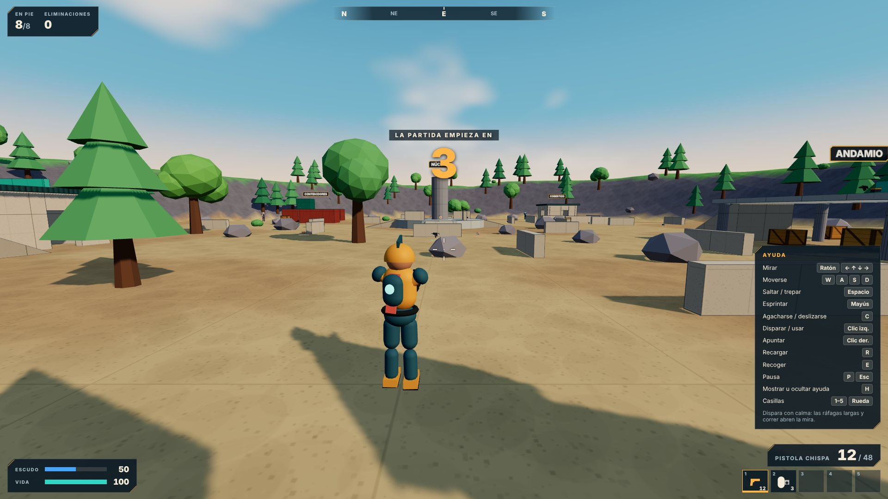

# NEXUS ROYALE (nombre provisional)

Shooter 3D original en tercera persona para navegador, construido por fases. **No es una réplica
de ningún juego existente**: nombre, universo, personajes, mapas, interfaz y sonido son propios,
y todo el arte se genera por código (no hay modelos, texturas ni audio de terceros).

**Estado: fase 2 de 6 completada.** Hay tres experiencias jugables en solitario:

| Experiencia | Mapa | Qué es |
|---|---|---|
| **Circuito de Anclas** | Campo de Pruebas | Contrarreloj de movimiento: esprintar, saltar, trepar, deslizarse |
| **Galería de Tiro** | Galería de Tiro | Práctica libre con las cinco armas contra maniquíes a 10, 25, 50 y 80 m |
| **Escaramuza** | Cantera Ámbar | Todos contra todos frente a 3, 5, 7 u 11 bots de práctica; gana el último en pie |

Los rivales de la Escaramuza son **bots**, y el juego lo dice en el lobby, en el HUD y en los
resultados. No hay multijugador todavía. La partida Royale con zona, botín y construcción, los
demás modos, la taquilla y el editor están planificados y aún no existen — ver
[`ROADMAP.md`](ROADMAP.md) y el estado verificable en [`docs/PROGRESO.md`](docs/PROGRESO.md).



## Jugar

Sin instalar nada: <https://claude.ai/artifact/WwSRHF94gLVuTfzmAGApTr> (enlace privado del autor).

En local:

```bash
npm install
```

```bash
npm run dev
```

| Acción | Teclado y ratón | Táctil |
|---|---|---|
| Moverse | `W` `A` `S` `D` | Mitad izquierda de la pantalla |
| Mirar | Ratón (o arrastrar, o flechas) | Arrastrar en el resto de la pantalla |
| Saltar y trepar bordes | `Espacio` | Botón ▲ |
| Esprintar | `Mayús` | Empujar el stick a fondo |
| Agacharse / deslizarse | `C` (deslizarse si vas esprintando) | Botón ▼ |
| Disparar / usar objeto | Clic izquierdo | Botón de disparo |
| Apuntar | Clic derecho (mantener, o alternar en Ajustes) | Botón de mira (alterna) |
| Recargar | `R` | Botón de recarga |
| Recoger | `E` | Tocar el aviso «Recoger…» |
| Cambiar de casilla | `1`–`5` o rueda del ratón | Tocar la casilla |
| Pausa | `P` o `Esc` | Botón de pausa |
| Reiniciar circuito | `Retroceso` | Menú de pausa |
| Ayuda | `H` | — |

Añade `?seed=123` a la dirección para repetir exactamente la misma Escaramuza (mismos puntos de
aparición, equipo y decisiones de los bots).

## Comandos

| Comando | Qué hace |
|---|---|
| `npm run check` | Comprueba tipos del núcleo, las pruebas y el cliente (TypeScript estricto) |
| `npm test` | Compila y ejecuta las pruebas unitarias del núcleo (`node:test`) |
| `npm run dev` | Servidor de desarrollo de Vite |
| `npm run build` | Comprobación de tipos + build de producción en `dist-web/` |
| `npm run build:artifact` | Build en un único HTML autocontenido en `dist-artifact/` |
| `npm run test:e2e` | Build + prueba en Chromium real (teclado, ratón y táctil) |
| `node tests/e2e/perf.mjs` | Mide el tiempo de cuadro por preset gráfico en esta máquina |

La prueba de navegador usa Playwright; la primera vez en tu equipo:

```bash
npx playwright install chromium
```

## Cómo está organizado

```text
src/core/         Dominio puro: sin DOM, sin Three.js, sin reloj ni azar implícitos.
  sim/            Mundo de colisiones, personaje, cámara, armas, inventario, botín, navegación,
                  bots y reglas por modo: la simulación completa a 60 Hz.
  maps/           Mapas como datos (Campo de Pruebas, Galería de Tiro, Cantera Ámbar).
  meta/           Ajustes y guardado versionado con validación y migración.
  *.ts            Reglas del kit: daño, tormenta, Pilares, Recarga, XP, moneda.
src/client/       Navegador: render (Three.js), entrada, audio, interfaz (React).
tests/            Pruebas unitarias (node:test) y tests/e2e (Playwright).
tools/            Scripts de empaquetado.
docs/             Especificación del proyecto, progreso y evidencias.
data/             Configuración de ejemplo del kit (modos, armas, misiones...).
legacy/           Juego anterior del repositorio, conservado.
```

La simulación es la única fuente de verdad: avanza a pasos fijos de 1/60 s y da el mismo
resultado a cualquier velocidad de render. El cliente solo dibuja su estado y le envía intención
(`InputFrame`), que es lo mismo que hará un servidor autoritativo cuando exista multijugador.

## Juego anterior

El tower defense que vivía en la raíz se conserva sin cambios en
[`legacy/nexo-tower-defense/`](legacy/nexo-tower-defense/) (abre su `index.html`).
