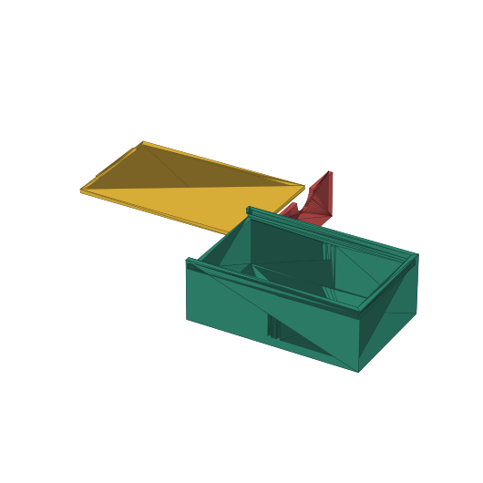

# Reto 9 · Caja de repuestos escolares con tapa corrediza

Ejes como en Tinkercad: **X = largo · Y = ancho · Z = alto**. Medidas en mm.
Posición = distancia desde la esquina de la caja (Regla en la esquina 0,0).

## Cuerpo

| Paso | Figura | Tipo | Tamaño X × Y × Z | Posición X, Y, Z |
|---|---|---|---|---|
| 1 | Caja exterior | Sólido | 70 × 45 × 25 | 0, 0, 0 |
| 2 | Hueco interior | Agujero | 66 × 41 × 24 | 2, 2, 2 |
| — | **Agrupar 1 + 2** | | | |
| 3 | Divisor central | Sólido | 2 × 41 × 18 | 34, 2, 2 |
| — | **Agrupar con lo anterior** | | | |
| 4 | Ranura de guías | Agujero | 70,5 × 44 × 2 | −1; 0,5; 21 |
| 5 | Entrada delantera | Agujero | 3,5 × 41 × 5 | −1, 2, 21 |
| — | **Agrupar todo → cuerpo terminado** | | | |

## Tapa

| Paso | Figura | Tipo | Tamaño X × Y × Z | Posición X, Y, Z |
|---|---|---|---|---|
| 6 | Placa de la tapa | Sólido | 69 × 43 × **1,5** | 0; 1; 21,25 |
| 7 | Relieve para empujar | Sólido | 3 × 25 × 1,5 | 4; 10; 22,75 |
| — | **Agrupar 6 + 7 → tapa** | | | |

Tapa de 1,5 mm en ranura de 2 mm = 0,25 mm de juego arriba y abajo
(con 2 mm no quedaba juego y la tapa se trababa).

Holguras: ranura de 44 mm de ancho y tapa de 43 mm = **0,5 mm por lado**;
ranura hasta 69,5 mm y tapa de 69 mm = 0,5 mm al fondo.

Archivos de comprobación en `salida/` (`caja_cuerpo.stl`, `caja_tapa.stl`,
`caja_ensamblada.stl`) generados con `generar_caja.py` con las mismas figuras.
