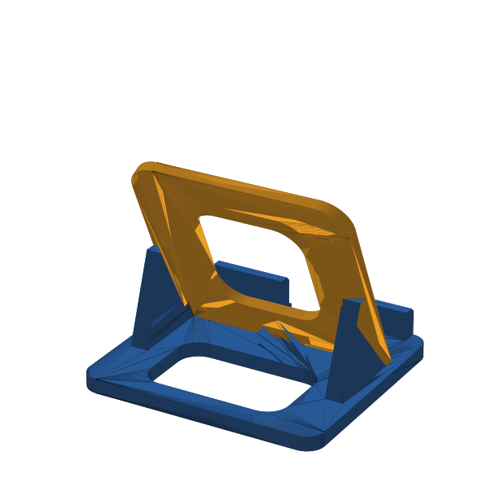

# Reto 14 · Soporte desmontable para celular

Base y respaldo que se arman **sin pegamento**: dos pestañas del respaldo entran
en dos ranuras inclinadas de la base y dos cuñas lo sostienen por detrás.

 

## Ficha técnica

| Dato | Valor |
|---|---|
| Piezas | 2 (base + respaldo) |
| Medida armado | **68 × 62 × 56,6 mm** (límite 80 × 80 × 60) |
| Base | 68 × 62 × 28 mm, plancha de 4 mm |
| Respaldo | 62 × 62 × 3 mm, inclinado 65° |
| Unión | 2 pestañas de 14 × 3 mm en ranuras inclinadas |
| Holgura | 0,2 mm por lado |
| Canal del celular | 12 mm (sirve con funda gruesa) |
| Tope delantero | 8 mm de alto, con muesca de 16 mm para el cable |
| Material | PLA, ~19 g en total |

## Archivos (`salida/`)

| Archivo | Para qué |
|---|---|
| `1_base.stl` | pieza 1, ya en posición de impresión |
| `2_respaldo.stl` | pieza 2, acostada para imprimir sin soportes |
| `soporte_ensamblado.stl` | las dos armadas, para mostrar en Tinkercad |
| `soporte_color.obj` | armado con colores |
| `prueba_probeta_holgura.stl` + `prueba_llave.stl` | prueba de ajuste (imprimir primero) |

## Impresión (estimado en PrusaSlicer; verificar en Cura / Bambu Studio)

| Ajuste | Base + respaldo juntos |
|---|---|
| Capa 0,20 mm · relleno 15 % · 2 paredes | ~91 min · 19 g (velocidades lentas, 50 mm/s) |
| Capa 0,28 mm · relleno 15 % · 2 paredes | **~75 min** · 20 g |
| Bambu Studio "0.20 Standard" | más rápido (~40–50 min) |

Sin soportes. Si en Cura sale más de 90 min, usa capa 0,28 o relleno 10 %.

## Prueba de ajuste

La probeta tiene 3 ranuras con holgura de 0,1 · 0,2 · 0,3 mm (1, 2 y 3 rayas).
Mete la llave en cada una:
- Entra con presión suave y no se cae → esa es tu holgura.
- Si la buena es la de 1 o 3 rayas, cambia `HOLGURA` en `generar_soporte.py`
  a 0,1 o 0,3 y vuelve a generar las piezas.

## Criterios de éxito y pruebas sugeridas (para el objetivo D)

| Criterio | Prueba | Se cumple si… |
|---|---|---|
| Cabe en 80 × 80 × 60 mm | medir con regla o vernier | todas las medidas ≤ límite |
| Imprime en ≤ 90 min | captura de Cura / Bambu | tiempo estimado ≤ 90 min |
| Se arma y desarma sin herramientas | armar y desarmar 10 veces | no se rompe ni se suelta |
| Ajuste correcto | probeta + llave | la llave no queda floja ni forzada |
| Sostiene el celular estable | poner el celular vertical y horizontal, tocar la pantalla 20 veces | no se vuelca ni resbala |
| Permite cargar | conectar el cable por la muesca | el cable pasa sin doblarse |

## Modificar

```bash
pip install trimesh shapely numpy scipy networkx mapbox_earcut manifold3d
python3 generar_soporte.py
```
