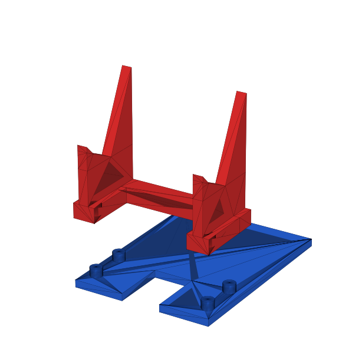
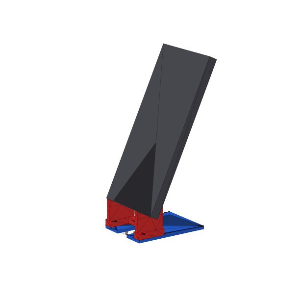
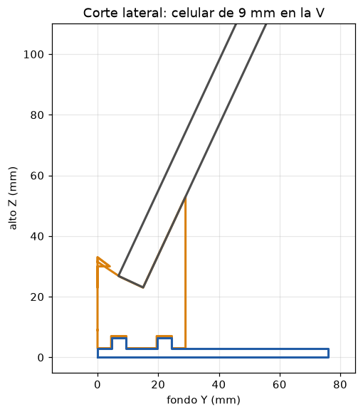
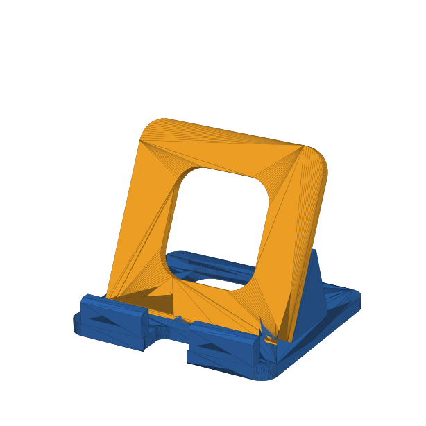

# Reto 14 · Soporte desmontable para celular (versión final)

**Una base y un respaldo** que encajan **como LEGO**: la base tiene 4 botones
redondos y el respaldo 4 agujeros en sus pies. Se arma a presión y se desarma tirando hacia arriba.

 

## Cómo funciona

- **Cuna en V:** la repisa baja hacia atrás a 25° y forma 90° con el apoyo de 65°.
  El celular se calza solo en la esquina y no resbala, tenga o no funda (de 7 a 12 mm de grosor).
- **Centro libre:** el celular se apoya en los dos laterales a 20 mm de altura;
  por el medio entra el cargador y no se tapa el parlante.
- **Vertical u horizontal:** los laterales están a 48 mm entre centros.
- **Base sólida:** placa llena de 3 mm (más peso y rigidez), con una muesca adelante por donde baja el enchufe.
- **No se vuelca:** la base tiene 76 mm de fondo y el centro de masa del celular queda
  a unos 30 mm del borde trasero.

## Ficha técnica

| Dato | Valor |
|---|---|
| Piezas | 2: base + respaldo |
| Medida armado | **57 × 76 × 53 mm** (límite 80 × 80 × 60) |
| Unión | 4 botones Ø 4,8 × 3,5 mm en agujeros Ø 5,0 × 4 mm (0,1 mm de juego por lado) |
| Ángulo del celular | 65° respecto a la mesa |
| Grosor de celular | 7 a 12 mm (con funda) |
| Material | PLA, ~17 g |
| Impresión | sin soportes; base acostada, respaldo acostado sobre su espalda |

## Paso a paso en Tinkercad

Regla en la esquina de la base. X = ancho, Y = fondo (Y = 0 es el frente, donde va la pantalla), Z = alto.
La posición es la esquina de cada figura (lo que marca la Regla).

### Pieza 1 · Base

| Paso | Figura | Tipo | Tamaño X × Y × Z | Posición X ; Y ; Z |
|---|---|---|---|---|
| 1 | Placa sólida | Caja sólida | 57 × 76 × 3 | 3,5 ; 0 ; 0 |
| 2 | Muesca del cable | Caja agujero | 16 × 23 × 5 | 24 ; −1 ; −1 |
| 3 | **Agrupar 1 + 2** | | | |
| 4 | 4 botones | Cilindro sólido | 4,8 × 4,8 × 3,5 | (5,6 ; 4,6 ; 3) · (5,6 ; 19,6 ; 3) · (53,6 ; 4,6 ; 3) · (53,6 ; 19,6 ; 3) |
| — | **Agrupar todo → base** | | | |

### Pieza 2 · Respaldo

Primero el lateral izquierdo:

| Paso | Figura | Tipo | Tamaño X × Y × Z | Posición X ; Y ; Z |
|---|---|---|---|---|
| 5 | Cuerpo | Caja sólida | 4 × 29 × 20 | 6 ; 0 ; 3 |
| 6 | Repisa | Cuña sólida, **alta adelante** | 4 × 15 × 7 | 6 ; 0 ; 23 |
| 7 | Tope | Cuña sólida, **alta adelante** | 4 × 4 × 4 | 6 ; 0 ; 28,2 |
| 8 | Apoyo | Cuña sólida, **alta atrás** | 4 × 14 × 30 | 6 ; 15 ; 23 |
| 9 | Pie | Caja sólida | 9 × 29 × 6 | 3,5 ; 0 ; 3 |

Selecciona los pasos 5 a 9, **duplica (Ctrl + D)** y mueve la copia 48 mm a la derecha
(el pie de la copia queda en X = 51,5). Luego:

| Paso | Figura | Tipo | Tamaño X × Y × Z | Posición X ; Y ; Z |
|---|---|---|---|---|
| 10 | Barra trasera | Caja sólida | 57 × 8 × 6 | 3,5 ; 21 ; 3 |
| 11 | 4 agujeros | Cilindro agujero | 5 × 5 × 5 | (5,5 ; 4,5 ; 2) · (5,5 ; 19,5 ; 2) · (53,5 ; 4,5 ; 2) · (53,5 ; 19,5 ; 2) |
| — | **Agrupar todo → respaldo** | | | |

"Alta adelante" = la parte alta de la cuña en Y = 0; "alta atrás" = la parte alta en Y = 29.
Gira cada cuña con las flechas curvas hasta que quede como en `vista_corte.png`.

**Para imprimir:** base tal cual; respaldo girado 90° para que quede apoyado sobre su
espalda (la cara plana de atrás, Y = 29) sobre la cama. Así no necesita soportes.

## Prueba de ajuste (imprimir primero, ~18 min)

- `prueba_agujeros.stl`: bloque con 3 agujeros Ø 4,9 · 5,0 · 5,1 mm (1, 2 y 3 rayas),
  acostados igual que en el respaldo.
- `prueba_botones.stl`: placa con 3 botones Ø 4,8 mm.

| Resultado | Qué hacer |
|---|---|
| El de 2 rayas (Ø 5,0) entra con presión y no se suelta | dejar Ø 5,0 |
| Solo entra el de 3 rayas | cambiar los agujeros del paso 11 a Ø 5,1 |
| El de 1 raya ya queda firme | cambiar los agujeros del paso 11 a Ø 4,9 |

## Impresión (PrusaSlicer a 50 mm/s; verificar en Cura / Bambu Studio)

| Ajuste | Base + respaldo |
|---|---|
| Capa 0,20 mm · relleno 15 % · 2 paredes | **~78 min · 17 g** |
| Capa 0,20 mm · relleno 25 % (base más pesada) | ~83 min · 18 g |
| Capa 0,28 mm · relleno 15 % · 2 paredes | ~65 min · 18 g |

## Dos alternativas (objetivo B)

| Criterio | A: base + respaldo con pestañas | B: base + respaldo tipo LEGO con cuna en V (elegida) |
|---|---|---|
| Medidas | 68 × 62 × 56,6 mm | 57 × 76 × 53 mm |
| Tiempo (capa 0,20) | ~91 min, pasa el límite | ~78 min |
| Unión | 2 pestañas de 4 mm, se sueltan fácil | 4 botones redondos, encaje firme |
| Cargar el celular | el enchufe choca con la base | centro libre a 20 mm de altura |
| Grosor de celular | canal fijo de 12 mm | cuna en V: 7 a 12 mm |
| Soportes de impresión | no | no |

## Registro de cambios (objetivo C)

| Versión | Cambio | Por qué |
|---|---|---|
| 1 → 2 | Pestañas → botones tipo LEGO | unión más firme y fácil de armar |
| 1 → 2 | Repisa elevada a 20 mm, centro abierto | en la v1 no se podía enchufar el cargador |
| 2 → 3 | Dos laterales sueltos → un respaldo con barra | menos piezas sueltas y siempre alineadas |
| 2 → 3 | Respaldo impreso acostado, no de pie | de ~85 a ~66 min y capas en la dirección fuerte |
| 2 → 3 | Canal recto → cuna en V | el tope colgaba al imprimir; la V acepta cualquier grosor |
| 2 → 3 | Base llena → marco en U | menos material, mismo fondo de 76 mm |

## Criterios de éxito y pruebas (objetivo D)

| Criterio | Prueba | Se cumple si… |
|---|---|---|
| Medidas | regla o vernier | todo ≤ 80 × 80 × 60 mm |
| Tiempo | captura de Cura / Bambu | ≤ 90 min |
| Encaje tipo LEGO | armar y desarmar 20 veces | entra a presión y no se afloja |
| Estabilidad | celular vertical y horizontal, tocar la pantalla 20 veces | no se vuelca ni se mueve |
| Carga | enchufar el cargador con el celular puesto | el enchufe entra sin forzar |
| Grosor | probar sin funda y con funda | se calza en la V en los dos casos |

## Archivos para ver en Tinkercad con colores

Importa los 3 (mm, 100 %) sin moverlos; entran en su lugar solos:
`tinkercad_base_azul.stl` (azul) · `tinkercad_respaldo_rojo.stl` (rojo) · `tinkercad_botones_amarillo.stl` (amarillo).
Llevan 2 cubitos de 0,2 mm en las esquinas para alinearse; para imprimir usa `1_base.stl` y `2_respaldo.stl`.

| Versión | Cambio | Por qué |
|---|---|---|
| 3 → 3.1 | Tope delantero bajado a Z = 28,2 y de 4 mm de alto | en la v3 el tope solo tocaba la repisa por una línea y quedaba suelto |
| 3.1 → 4 | Base en U → placa sólida con muesca para el cable | más peso y rigidez para sostener el celular; el enchufe sigue pasando por la muesca |
