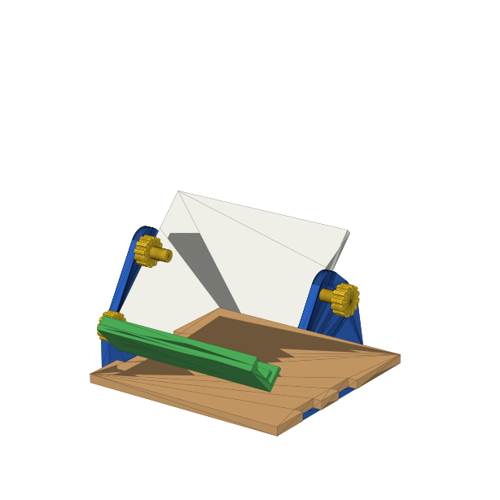
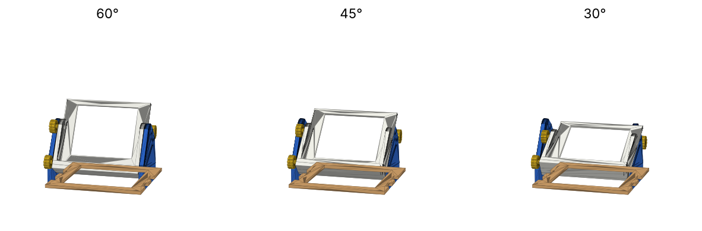
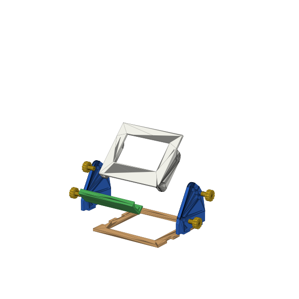
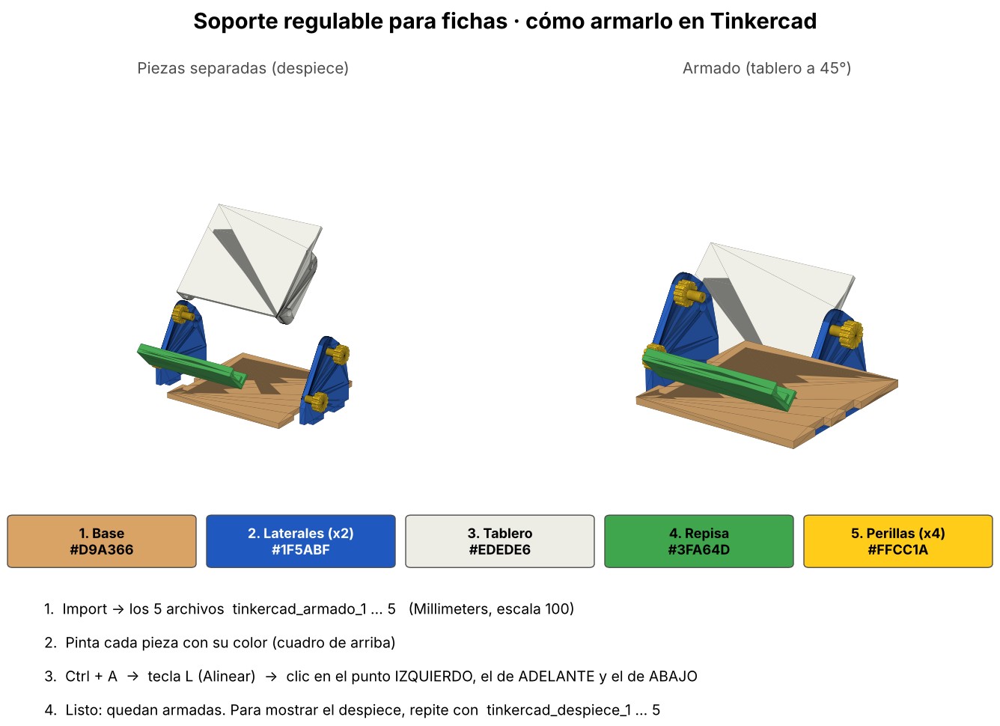

# Soporte regulable para fichas y carteles

Soporte con **3 inclinaciones (60°, 45° y 30°)**, inspirado en la imagen de referencia.
El tablero gira sobre dos perillas (eje) y otras dos perillas lo traban en el ángulo elegido.





## Piezas y colores

| Pieza | Cantidad | Color | Archivo para imprimir |
|---|---|---|---|
| Base sólida (72 × 70 × 3 mm con 4 ranuras) | 1 | Madera `#D9A366` | `1_base.stl` |
| Lateral (aleta de 3 mm con 1 agujero de giro + 3 de inclinación) | 2 | Azul `#1F5ABF` | `2_lateral_imprimir_x2.stl` |
| Tablero sólido (65 × 54 × 2 mm, 2 orejas atrás con agujeros) | 1 | Blanco `#EDEDE6` | `3_tablero.stl` |
| Repisa (se encaja en el borde de abajo del tablero, con tope en rampa) | 1 | Verde `#3FA64D` | `5_repisa.stl` |
| Perilla (cabeza Ø 10 estriada + vástago Ø 4) | 4 | Amarillo `#FFCC1A` | `4_perilla_imprimir_x4.stl` |

## Cómo funciona

1. Las pestañas de cada lateral entran a presión en las ranuras de la base.
2. Dos perillas pasan por el **agujero de giro** del lateral y entran en la oreja del tablero: es el eje.
3. Se inclina el tablero y se meten las otras dos perillas en uno de los **3 agujeros de inclinación**:
   arriba = 60° (más vertical), medio = 45°, abajo = 30° (más inclinado).
4. La repisa se encaja a presión en el borde de abajo del tablero (canal de 2,2 mm para la placa de 2 mm).
5. La ficha se apoya en la repisa; el tope en rampa evita que resbale.

## Medidas

| Dato | Valor |
|---|---|
| Armado con perillas | **80 × 75,6 × 59,1 mm** (a 60°; límite 80 × 80 × 60) |
| Eje de giro | Y = 14, Z = 14 mm |
| Agujeros de inclinación | a 28 mm del eje, separados 7,3 mm |
| Perilla / agujero | Ø 4,0 / Ø 4,3 mm (0,15 mm de juego por lado) |
| Ficha que entra | hasta 65 mm de ancho (cualquier alto) y 6 mm de grosor, comprobado en los 3 ángulos |
| Material | PLA, ~30 g |

## En Tinkercad (con colores)



1. **Import** → los 5 archivos `tinkercad_armado_1_base_madera.stl` … `tinkercad_armado_5_perillas_amarillo.stl`
   (Millimeters, escala 100).
2. Pinta cada pieza: 1 base `#D9A366` · 2 laterales `#1F5ABF` · 3 tablero `#EDEDE6` · 4 repisa `#3FA64D` · 5 perillas `#FFCC1A`.
3. **Ctrl + A → tecla L (Alinear) →** clic en el punto **izquierdo**, el **de adelante** y el **de abajo**.
   Todos los archivos tienen la misma caja (2 cubitos de 0,2 mm en las esquinas), así que quedan exactos
   en su lugar aunque Tinkercad los haya puesto en sitios distintos. Comprobado simulando la importación:
   desfase 0 mm y ninguna pieza se cruza con otra.
4. Para mostrar las piezas separadas, haz lo mismo con `tinkercad_despiece_1 … 5`.
5. Si algo falla: `tinkercad_TODO_JUNTO_un_color.stl` es el soporte entero en una sola pieza.

Para imprimir usa los archivos `1_` a `5_` (sin cubitos).

## Prueba de ajuste

`prueba_agujeros.stl` (agujeros Ø 4,1 · 4,2 · 4,3 · 4,4) + `prueba_perilla.stl`.
Usa el diámetro en el que la perilla entra con presión suave y no se cae; si no es 4,3,
cambia `D_AGUJERO` en `generar_soporte_fichas.py` y vuelve a generar.

## Impresión (estimado en PrusaSlicer; verificar en Cura / Bambu Studio)

| Ajuste | Todas las piezas juntas |
|---|---|
| Impresora rápida (tipo Bambu), capa 0,20 | ~92 min · 30 g |
| Impresora lenta (50 mm/s), capa 0,28 | ~115 min · 33 g |
| Impresora lenta (50 mm/s), capa 0,20 | ~132 min · 30 g |

Se puede imprimir en dos tandas (base + laterales, y tablero + repisa + perillas).

Sin soportes: base plana, laterales acostados (agujeros redondos), tablero con la cara
delantera sobre la cama (orejas arriba), repisa apoyada en su piso y perillas con la cabeza abajo.

## Regenerar

```bash
pip install trimesh shapely numpy scipy networkx mapbox_earcut manifold3d
python3 generar_soporte_fichas.py
```
