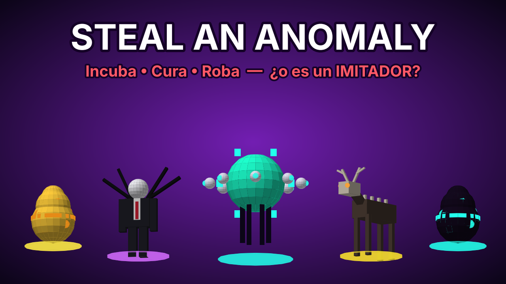

# 👁 Steal an Anomaly: juego para Roblox



Juego completo y listo para abrir en **Roblox Studio** (`StealAnAnomaly.rbxlx`).
Combina los tres fenómenos del informe *Anatomía de la Viralidad en Roblox (2026)* en un bucle propio:

| Viene de… | Qué aporta |
|---|---|
| 🥚 **Steal an Egg** | Mercado central con restock global, huevos que cargas a mano y te pueden quitar, incubadoras y eclosión aleatoria |
| 🏥 **Animal Hospital (Anomaly)** | Tu base es una **clínica**. Atiendes los síntomas de tus pacientes, buscas señales en **fotos Polaroid** y vigilas tu **cordura** en el turno de noche |
| 🧠 **Steal a Brainrot** | Robar pacientes, ingresos por segundo, láser en la puerta y bate |

## ▶ Cómo abrirlo

1. Abre `StealAnAnomaly.rbxlx` con Roblox Studio (*File → Open from File*) y pulsa **Play**. Todo se genera solo: mapa, criaturas, huevos, interfaz, monitores y efectos.
2. Para que se guarde el progreso:
   - Publica el juego.
   - Activa *Game Settings → Security → Enable Studio Access to API Services*.
3. En *Game Settings → Places*, pon **Max Players = 8**.

> Para regenerar el `.rbxlx` después de editar `src/`, ejecuta `python3 build_rbxlx.py`.

## 🔁 El bucle

```
 🥚 MERCADO DE LA GRIETA (centro)          restock cada 60 s · GRAN RESTOCK cada 5 min
        │ mantén E: comprar huevo
        ▼
 ✋ Lo cargas sobre la cabeza  ──►  ¡te pueden pegar con el bate y quitártelo!
        ▼
 🐣 INCUBADORA (tiempo según rareza; los huevos tiemblan antes de romperse)
        ▼   ¡HA NACIDO!  (revelación con confeti; rareza y mutación al azar)
 🛏 CAMA DE PACIENTE  ──►  genera $/s mientras esté ESTABLE
        │   🔥🌀💢🍖 síntomas: mantén R para tratar (combo x5 de propinas)
        ▼
 💰 Pisa la CAJA  ►  mejores huevos  ►  mejora la clínica  ►  ASCIENDE
```

## 🧠 Mecánicas únicas

### 📸 Cámara Polaroid e Imitadores
Alrededor del **13 % de los huevos (desde el Raro) están contaminados**: eclosionan un **IMITADOR** que se ve igual que una anomalía real.

- Saca una **foto** (tecla 1). La foto se revela poco a poco y, si es un Imitador, muestra **señales**:
  - 👁 ojos rojos
  - ⬛ silueta negra
  - 🙃 imagen invertida
  - 🫥 sin cabeza
  - 📺 estática roja
- Las fotos reales a veces tienen **artefactos inofensivos** (destello de luz, grano, desenfoque). Eso obliga a deducir.
- **Fotografiar un huevo** muestra su contenido en **rayos X**. Así sabes qué hay dentro antes de comprarlo… o de robarlo.
- Pulsa **🚨 Reportar**:
  - Si acertaste, ganas el 60 % de su valor.
  - Si era real, pagas una **multa** y pierdes cordura.
- Un Imitador sin descubrir **devora tu paciente más valioso** en el turno de noche.
- También puedes dejar uno como **cebo**: si te lo roban, devora en la clínica del ladrón.

Las criaturas también tienen pistas visuales sueltas: ojos rojos, sin sombra, caminan de espaldas, parpadean o tienen el color cambiado.

### 🩺 Cuidar pacientes (co‑op)
- Cada paciente enferma cada 70‑140 s con uno de cuatro síntomas: 🔥 Fiebre, 🌀 Glitch, 💢 Pánico o 🍖 Hambre.
- Mientras está enfermo **no produce dinero**. Si pasan 60 s sin tratarlo queda **CRÍTICO** y se fuga en el turno de noche.
- Los monitores de cada cama muestran un **ECG animado** que cambia de color y ritmo según el estado.
- Tratar da propina, y los tratamientos seguidos suben un **COMBO** hasta x5.
- **Cualquier jugador puede tratar a tus pacientes** (se lleva media propina): esto empuja el co‑juego que premia el algoritmo.

### ☾ Turno de noche (cada 5 min, 50 s)
- El cielo se vuelve rojo, se apagan las farolas y cada jugador lleva linterna.
- **Caen todos los láseres**.
- **GRAN RESTOCK**: todos los pedestales se llenan de huevos mucho mejores, con al menos uno Legendario o mejor.
- **Los Imitadores despiertan** y devoran.
- **Los pacientes CRÍTICOS se fugan**, y cualquiera puede capturarlos.
- 🧠 **Cordura**: baja fuera de tu clínica y cae en picado cerca de Imitadores sueltos.
  - Al bajar, la pantalla pierde color, aparece una viñeta, se nubla y suenan latidos.
  - A 0 **te desmayas** (sueltas lo que lleves y despiertas en tu clínica).
  - Recupérala en tu clínica o con la **☕ cafetera**.

### 🔒 Defensa
- **Láser** en la puerta (60 s y más con cada mejora): el dueño lo atraviesa, los demás no.
- **Bate** (tecla 2): si golpeas a quien carga un huevo o un paciente, lo suelta.
  - Si era robado, vuelve a su dueño.
  - Si no, queda tirado y lo recoge el primero que llegue.
- Alerta de robo con sirena, y el ladrón queda resaltado en rojo.

## 🥚 Huevos

| Huevo | Precio | Incubación | Contenido |
|---|---|---|---|
| Común | $100 | 20 s | 85 % Común / 15 % Raro |
| Raro | $1.5K | 40 s | 75 % Raro / 25 % Épico |
| Épico | $20K | 80 s | 78 % Épico / 22 % Legendario |
| Legendario | $150K | 2:20 | 82 % Legendario / 18 % Mítico |
| Mítico | $1M | 3:40 | 88 % Mítico / 12 % SECRETO |
| Huevo del Vacío | $8M | 5:00 | 100 % SECRETO (casi solo en el Gran Restock) |

**Mutaciones:**

| Mutación | Multiplicador | Probabilidad |
|---|---|---|
| Dorado | x2 | 6 % |
| Glitch | x3 | 3 % |
| Vacío | x5 | 1,5 % |
| Espectral | x10, arcoíris | 0,5 % |

En el Gran Restock la probabilidad de mutación es doble.

## 👾 Bestiario (14 anomalías)

| Rareza | Anomalías |
|---|---|
| Común | Ojo Vigilante · Tele Viviente · Cubo Hambriento |
| Raro | Medusa del Vacío · Gato Duplicado · Cuello Largo |
| Épico | Reloj Sin Tiempo · Árbol Susurrante · Sin Rostro |
| Legendario | Skinwalker · Ángel Glitcheado |
| Mítico | Luna Sonriente · ERROR_404 |
| SECRETO | La Entidad ∞ |

## 📈 Retención (según el informe)

| Señal | En el juego |
|---|---|
| Restock físico de 5 min (FOMO) | Mini‑restock cada 60 s y **Gran Restock** en el turno de noche: todos corren al centro |
| D1 / D7 | Racha de 7 días (el día 7 regala un Huevo Épico), 3 misiones diarias, huevos que siguen incubando offline y dinero offline |
| Co‑Play | +10 % de dinero por amigo (máx. +50 %), tratar pacientes ajenos y botón 👥 Invitar |
| Metas corto/medio/largo | Próxima eclosión → mejorar la clínica (10 camas, 4 incubadoras) → Índice completo y Ascensos |
| Spend Signal | Pack Inicial de 25 R$, Eclosión Instantánea, pases (VIP, Auto‑Caja, Cámara PRO, Incubadora Turbo, Zapatillas) |
| Clips virales | Imitadores devorando, revelación al eclosionar, desmayos por cordura y huevos robados por el camino |

## 🛠 Configuración

Todo el balance está en `src/ReplicatedStorage/Shared/Config.lua`: huevos, probabilidades, tiempos, síntomas, cordura, multas, mejoras y monetización.

Los IDs de pases y productos se pegan en `Config.GamePasses` y `Config.Products`. Con Id = 0 el botón avisa en vez de abrir la compra.

**Códigos:** `ANOMALIA`, `APAGON`, `LANZAMIENTO`, `POLAROID`, `HOSPITAL`.

**Comandos de admin** (en Studio todos son admin):

| Comando | Efecto |
|---|---|
| `/apagon` | Fuerza el turno de noche |
| `/restock` | Gran Restock |
| `/lluvia` | 6 huevos Legendarios o Míticos |
| `/secreto` | Huevo del Vacío en el mercado |
| `/imitador` | Huevo contaminado |
| `/huevo <id>` | Te da un huevo concreto |
| `/eclosionar` | Eclosiona tus huevos al instante |
| `/dinero <n>` | Da dinero |

## 📂 Estructura

```
steal-an-anomaly/
├─ StealAnAnomaly.rbxlx          ← ábrelo en Roblox Studio
├─ build_rbxlx.py                ← genera mapa (mercado + 8 clínicas) y empaqueta scripts
├─ marketing/                    ← icono y miniatura
└─ src/
   ├─ ReplicatedStorage/Shared/  Config, AnomalyData, AnomalyBuilder (criaturas y huevos), Util
   ├─ ServerScriptService/       Main + Modules/
   │    Data · Anoms · Bases (clínicas) · Market · Care (síntomas) · Steal (robos, fotos)
   │    Sanity (cordura) · Cycle (día/noche) · Progression
   └─ StarterPlayerScripts/      ClientMain (HUD, Polaroid, monitores, efectos), AnomalyAnimator
```
