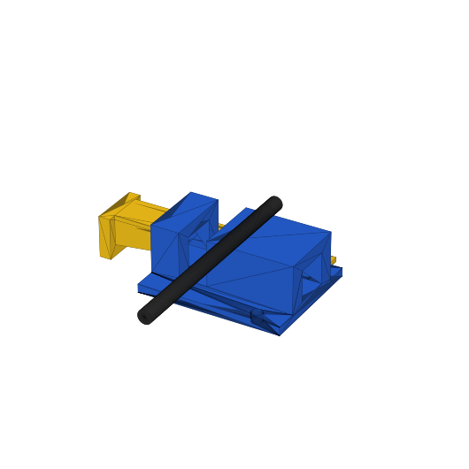
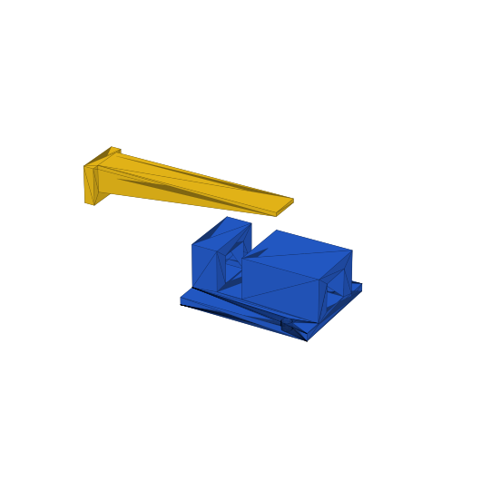
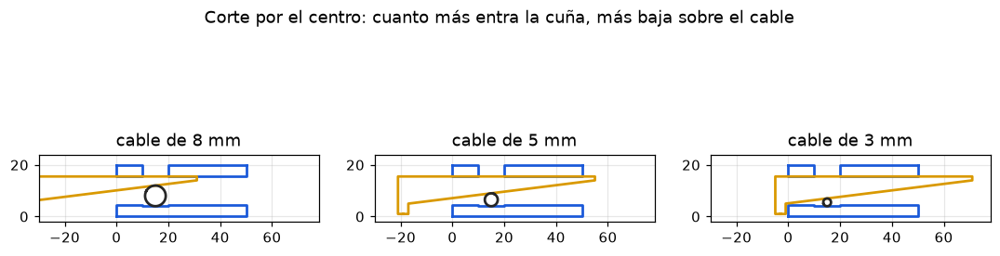

# Reto 11 · Sujetador de cables para escritorio con cuña ajustable

Una **base** que se atornilla o se pega al escritorio y una **cuña** que entra por un
túnel. Al empujar la cuña, su cara inclinada baja sobre el cable y lo aprieta;
al tirar del tirador se suelta. Sujeta cables de **3 a 8 mm** sin aplastarlos.

 

## Cómo funciona

- La cuña tiene pendiente **1:8 (7°)**: cada 8 mm que entra, baja 1 mm.
- 7° es menor que el ángulo de fricción del PLA (~17°), así que la cuña **no se suelta sola**.
- El lomo plano de la cuña se apoya en el techo del túnel; la cara inclinada toca el cable
  por arriba y el canal (10 mm de ancho) lo sostiene por abajo. No hay bordes que corten el cable.
- El tirador hace de tope: la cuña no se puede meter de más ni perder dentro del túnel.

| Posición de la punta de la cuña (X) | Espacio sobre el cable |
|---|---|
| 31 mm | 8,0 mm |
| 40 mm | 6,9 mm |
| 50 mm | 5,6 mm |
| 60 mm | 4,4 mm |
| 72 mm (tope) | 2,9 mm |

## Ficha técnica

| Dato | Valor |
|---|---|
| Piezas | 2: base + cuña |
| Base | 50 × 40 × 20 mm |
| Cuña | 76 × 18 × 14,5 mm (72 mm de rampa + tirador) |
| Armado (cuña al tope) | 76 × 40 × 20 mm (límite 80 × 80 × 60) |
| Canal del cable | 10 mm de ancho, cables de 3 a 8 mm |
| Túnel de la cuña | 12,4 × 11 mm (0,2 mm de juego por lado) |
| Fijación | 2 agujeros Ø 4 mm para tornillo, o cinta doble faz debajo |
| Material | PLA, ~15 g |
| Soportes de impresión | no necesita |

## Paso a paso en Tinkercad

Regla en la esquina de la base. X = largo (por donde corre la cuña), Y = ancho (por donde pasa el cable), Z = alto.

### Pieza 1 · Base

| Paso | Figura | Tipo | Tamaño X × Y × Z | Posición X ; Y ; Z |
|---|---|---|---|---|
| 1 | Pestaña para atornillar | Caja sólida | 50 × 40 × 3 | 0 ; 0 ; 0 |
| 2 | Bloque | Caja sólida | 50 × 24 × 20 | 0 ; 8 ; 0 |
| — | **Agrupar 1 + 2** | | | |
| 3 | Canal del cable | Caja agujero | 10 × 42 × 17 | 10 ; −1 ; 4 |
| 4 | Túnel de la cuña | Caja agujero | 52 × 12,4 × 11 | −1 ; 13,8 ; 4,5 |
| 5 | Agujero tornillo | Cilindro agujero Ø 4 | 4 × 4 × 5 | 38 ; 2 ; −1 |
| 6 | Agujero tornillo | Cilindro agujero Ø 4 | 4 × 4 × 5 | 38 ; 34 ; −1 |
| — | **Agrupar todo → base** | | | |

### Pieza 2 · Cuña (se dibuja como se imprime: lomo plano abajo)

| Paso | Figura | Tipo | Tamaño X × Y × Z | Posición X ; Y ; Z |
|---|---|---|---|---|
| 7 | Lomo | Caja sólida | 72 × 12 × 1,5 | 0 ; 0 ; 0 |
| 8 | Rampa | Cuña sólida, **alta en X = 0** y baja en X = 72 | 72 × 12 × 9 | 0 ; 0 ; 1,5 |
| 9 | Tirador | Caja sólida | 4 × 18 × 14,5 | −4 ; −3 ; 0 |
| — | **Agrupar 7 a 9 → cuña** | | | |

Para armarla: dala vuelta (lomo arriba) y métela por el lado X = 0 de la base, con la punta delgada primero.

## Prueba de ajuste (imprimir primero, ~18 min)

- `prueba_tuneles.stl`: placa con 3 ranuras pasantes de 12,2 · 12,4 · 12,6 × 11 mm (1, 2 y 3 rayas).
- `prueba_barra.stl`: barra de 12 mm de ancho, como la cuña.

| Resultado | Qué hacer |
|---|---|
| La barra pasa suave por la de 2 rayas sin bailar | dejar 12,4 mm |
| Solo corre en el de 3 rayas | cambiar el ancho del túnel (paso 4) a 12,6 y su posición Y a 13,7 |
| Ya corre bien en el de 1 raya | cambiar el ancho del túnel a 12,2 y su posición Y a 13,9 |

## Impresión (PrusaSlicer a 50 mm/s; verificar en Cura / Bambu Studio)

| Ajuste | Base + cuña |
|---|---|
| Capa 0,20 mm · relleno 15 % · 2 paredes | **~73 min · 15 g** |
| Capa 0,28 mm · relleno 15 % · 2 paredes | ~59 min · 16 g |

Base apoyada sobre su cara de abajo; cuña con el lomo plano sobre la cama. Sin soportes.

## Criterios de éxito y pruebas (objetivo D)

| Criterio | Prueba | Se cumple si… |
|---|---|---|
| Medidas | regla o vernier | ≤ 80 × 80 × 60 mm |
| Tiempo | captura de Cura / Bambu | ≤ 90 min |
| Sujeta sin dañar | cable USB, de cargador y de audífonos; apretar y soltar 10 veces | el cable no se marca ni se aplasta |
| Ajustable | probar cables de 3, 5 y 8 mm | los tres quedan firmes |
| No se suelta | tirar del cable con la mano | el cable no se desliza y la cuña no retrocede |
| Desmontable | sacar y meter la cuña 20 veces | corre sin trabarse |
