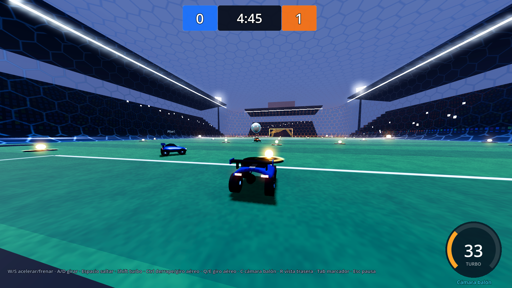

# VELOCITY ARENA

Juego 3D original de fútbol con coches, hecho con **Godot 4.4** y un motor de
físicas propio a 120 Hz. Estado actual: **alfa 0.3 jugable offline** (partidas
contra bots 1v1–4v4, 7 modos arcade, juego libre).

 

## Cómo jugar

1. Instala Godot **4.4.x** (estándar, no Mono): <https://godotengine.org/download>
2. Abre la carpeta `velocity-arena/` con Godot (Importar → `project.godot`) y pulsa ▶,
   o desde terminal: `godot --path velocity-arena`.

### Controles (teclado / mando)

| Acción | Teclado | Mando |
|---|---|---|
| Acelerar / frenar-reversa | W / S | RT / LT |
| Girar | A / D | Stick izq. |
| Cabeceo en el aire | W / S | Stick izq. vertical |
| Saltar (2.º salto = esquive con dirección) | Espacio / clic der. | A |
| Turbo | Shift / clic izq. | B |
| Derrape + giro aéreo libre | Ctrl | X |
| Giro aéreo direccional | Q / E | LB / RB |
| Cámara balón | C | Y |
| Vista trasera | R | R3 |
| Marcador | Tab | Back |
| Pausa | Esc | Start |
| Panel de físicas | F3 | — |

**Juego libre:** Retroceso = reiniciar coche · T = balón hacia ti · Y = tiro a tu
portería · H = balón sobre el coche · B = turbo infinito · G = baja gravedad.

## Qué incluye (verificado)

- Física propia: suspensión por rayos, conducción por paredes y techo, saltos de
  altura variable, doble salto, esquives en 8 direcciones, cancelación de flip,
  flip reset, control aéreo en 3 ejes, derrape, turbo, supersónico, demoliciones.
- Balón con giro, fricción, restitución y sin atravesar paredes a 60 m/s.
- Reglas completas: saque con cuenta atrás, reloj desde el primer toque, regla de
  0 segundos, prórroga a muerte súbita, goles/asistencias/paradas/tiros/demoliciones.
- Bots con 7 niveles (Principiante → Maestro), roles de equipo, saques con esquive,
  defensa, recogida de turbo, aéreos (nivel ≥ 4) y recuperación en el aire.
- Estadio "Velocity Stadium" procedural con 3 ambientes (noche/día/atardecer),
  público animado, pads de turbo, porterías con red luminosa.
- Vehículo original "Velocity X", partículas de turbo/supersónico/derrape,
  explosiones de gol y demolición, audio 100 % sintetizado.
- Menú principal 3D, HUD, marcador, pausa, ajustes persistentes (gráficos,
  audio, cámara, accesibilidad, idioma ES/EN), perfil local con XP y niveles.



Ver `PROGRESS.md` para el estado detallado y `ROADMAP.md` para lo que falta
(multijugador en línea, ranked, garaje, tienda, modos con estadios especiales…).

## Tests

```bash
godot --headless --path velocity-arena --import
godot --headless --path velocity-arena --script res://tests/run_tests.gd
```

Resultados reales en `TEST_RESULTS.md`.

## Licencia de assets

Todo el contenido visual y sonoro se genera por código en este repositorio. Ver
`ASSET_LICENSES.md`.
